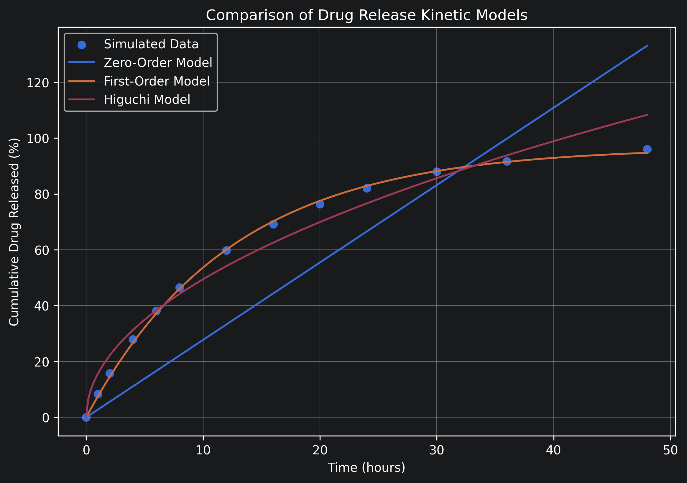

# Drug Release Kinetics Analyzer

A Python-based biomedical data analysis project for modeling and comparing controlled drug-release kinetics.

## Overview

Controlled drug-delivery systems are designed to release therapeutic compounds at a desired rate over time. This project uses Python to analyze a simulated controlled-release dataset and compare mathematical models describing drug-release behavior.

Three kinetic models were evaluated:

- Zero-order
- First-order
- Higuchi

Model performance was compared using the coefficient of determination (R²) and root mean squared error (RMSE).

## Results

| Model | R² | RMSE |
|---|---:|---:|
| Zero-order | 0.6303 | 19.48 |
| First-order | **0.9993** | **0.85** |
| Higuchi | 0.9685 | 5.69 |

The **first-order model provided the best fit**, with an R² of 0.9993 and an RMSE of 0.85 percentage points.

The fitted first-order model produced:

- Maximum cumulative release: approximately **96.7%**
- Release-rate constant: approximately **0.081 h⁻¹**
- Estimated t50: **8.57 hours**

## Analysis Workflow

1. Loaded and inspected time-series drug-release data
2. Visualized the cumulative release profile
3. Implemented zero-order, first-order, and Higuchi kinetic models
4. Fit model parameters using nonlinear curve fitting
5. Calculated R² and RMSE for model comparison
6. Estimated t50 from the best-fitting model
7. Interpreted differences in model behavior

## Technologies

- Python
- Pandas
- NumPy
- SciPy
- Matplotlib
- Jupyter Notebook

## Interpretation

The first-order model closely reproduced the simulated release profile and substantially outperformed the zero-order and Higuchi models.

The zero-order model assumes a constant release rate and therefore could not reproduce the plateau observed at later time points. The Higuchi model captured much of the early release behavior but showed greater deviation as cumulative release approached its maximum.

Because this project uses simulated data, the results demonstrate the drug-release modeling and data-analysis workflow rather than conclusions about a real pharmaceutical formulation.

## Repository Contents

- `drug_release_analysis.ipynb` — complete Python analysis and model fitting
- `drug_release_data.csv` — simulated drug-release dataset
- `model_comparison.png` — visualization of fitted kinetic models
- `requirements.txt` — Python dependencies
